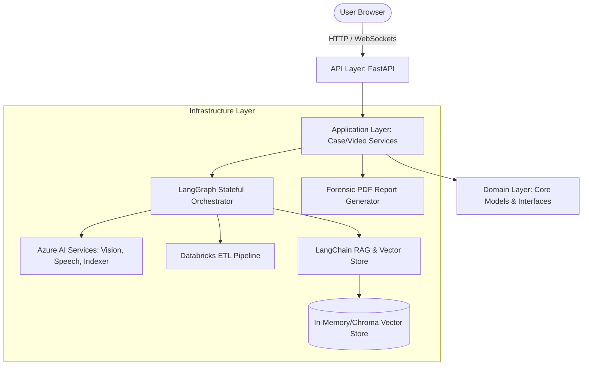

# AI-Driven Video Evidence Analysis System (Enterprise Edition)

A production-ready, enterprise-grade forensic video analytics and telemetry auditing platform. Styled after Microsoft Security Copilot and Palantir Gotham, the system processes raw evidence videos, orchestrates AI pipelines via **LangGraph**, processes logs via **Databricks Spark ETL**, indexes text transcripts and OCR using **LangChain RAG**, compiles legal PDF reports, and provides an interactive dashboard interface.

---

## System Architecture

The project is structured under **Clean Architecture** principles to isolate core domain business rules from external framework dependencies (FastAPI, Azure, Databricks, SQLite/JSON files).



---

## Analysis Workflow Sequence

```mermaid
sequenceDiagram
    autonumber
    actor Investigator as Law Enforcement / Officer
    participant UI as Glassmorphic Web Dashboard
    participant API as FastAPI Backend
    participant LG as LangGraph Workflow Engine
    participant Azure as Azure AI Services (Vision/OCR/Speech)
    participant DB as Databricks Spark Cluster
    participant LC as LangChain Vector Database

    Investigator->>UI: Input Case Reference & Select Video
    UI->>API: POST /api/cases (Create Case File)
    API-->>UI: Return Case ID
    UI->>API: POST /api/videos/upload (Upload Video Binary File)
    API-->>UI: Return 200 OK (Asynchronous Pipeline Started)
    
    rect rgb(10, 20, 35)
        note right of LG: LangGraph Stateful Execution
        API->>LG: compiled_workflow.invoke(state)
        LG->>LG: upload_node (Initialize metadata logs)
        LG->>LG: frame_extraction_node (Slices keyframes)
        par Parallel AI Node Execution
            LG->>Azure: analyze_speech (Transcribe audio stream)
            LG->>Azure: analyze_ocr (Extract text overlays)
            LG->>Azure: analyze_vision (Object & Face detection)
        end
        Azure-->>LG: Aggregate transcripts, bounding boxes & text logs
        LG->>LG: metadata_validation_node (Resolve overlapping timestamps)
        LG->>DB: trigger_etl_job (Submit batch cleanup Spark task)
        DB-->>LG: Return standardized records & data quality report
        LG->>LC: index_evidence (Generate embeddings & vector store indexing)
        LG->>LG: risk_analyzer_node (Dynamically calculate threat score)
        LG->>LG: timeline_generator_node (Format synchronized chronology)
        LG->>LG: report_generator_node (Compile forensic report & write PDF)
    end
    
    LG-->>API: Return final consolidated case state
    API->>API: Persist finished logs in case record database
    
    loop Real-time Polling
        UI->>API: GET /api/cases/{case_id}
        API-->>UI: Return active stage & state metrics (Update UI nodes)
    end
    
    Investigator->>UI: Query AI Chat: "Was a weapon detected?"
    UI->>API: POST /api/chat (Query RAG)
    API->>LC: retrieve_evidence (Fetch similar transcripts & timeline events)
    LC-->>API: Return matching contexts
    API-->>UI: Return Citation-rich response + Clickable video timestamps
    
    Investigator->>UI: Click "Export Forensic PDF"
    UI->>API: GET /api/reports/download/{case_id}
    API-->>UI: Stream compiled Forensic PDF (reportlab output)
```



---

## Detailed Directory Explanations

1. **`api/`**: Declares FastAPI routers. Configures CORS protocols, handles file streaming bounds, and defines API endpoints for managing cases, uploading videos, query prompts, and report retrieval.
2. **`application/`**: Use cases and orchestration logic. Contains interface contracts (`interfaces.py`) defining ports for external operations, and coordinates asynchronous thread workers executing state graphs.
3. **`domain/`**: Represents core entities (`models.py`) such as threat score indexes, detected vehicle metrics, transcripts, and timeline data schemas. Decoupled from Python frameworks.
4. **`infrastructure/`**: Core platform adaptors:
   - `azure/`: Handles Cognitive Services connections. Automatically defaults to a highly realistic mock engine if variables are absent, allowing flawless offline execution.
   - `databricks/`: Simulates cluster metadata cleaning. Includes `spark_etl.py` which contains production-grade PySpark code for catalog table updates.
   - `langchain/` & `rag/`: Creates local similarity indexers. Splits transcripts and text overrides into semantic chunks with jump timestamps.
   - `langgraph/`: Compiles state machines. Organizes nodes, parallel routes, validation loops, and dynamic error state updates.
   - `reports/`: Generates PDF documents using ReportLab. Renders custom headers, risk grids, chronological logs, and signature line blocks.
5. **`static/`**: High-end user interface:
   - `index.html`: Holds SPA elements.
   - `css/dashboard.css`: Implements a dark slate glassmorphism system using HSL colors, blur filters, pulsing node charts, and chat interfaces.
   - `js/`: Splits frontend into API managers (`api.js`), component render blocks (`components.js`), and core controller hooks (`app.js`) coordinating video jumps.

---

## Getting Started

### 1. Prerequisite Installations
Ensure Python 3.10+ is installed locally.

### 2. Setup Local Environment
Clone the repository and install requirements:
```bash
pip install -r requirements.txt
```

### 3. Run FastAPI Application
Start the backend dev server:
```bash
python -m api.main
```
Navigate your browser to `http://localhost:8000`. You can instantly:
- Create a Case.
- Drag and drop a sample video file (or any test video).
- Track the animated LangGraph stage transitions.
- Play the video, click timeline items to scrub playback, query the Chat Copilot assistant, and download forensic reports.

---

## Docker Containership Execution

### 1. Build and Start Container
Run using Docker Compose:
```bash
docker-compose -f docker/docker-compose.yml up --build
```
This builds the slim Python container, bootstraps standard directories, and exposes the frontend on port `8000`. Case records and uploaded videos are securely cached inside a docker volume.

---

## Databricks Pipeline Integration

To configure this project against an active Databricks workspace:
1. Upload `infrastructure/databricks/spark_etl.py` to your Databricks workspace.
2. Create a Job in your Databricks Cluster targeting the notebook.
3. Set the `DATABRICKS_HOST` and `DATABRICKS_TOKEN` variables in a `.env` file. The backend will trigger the job run using Databricks Jobs REST APIs on cases execution.
